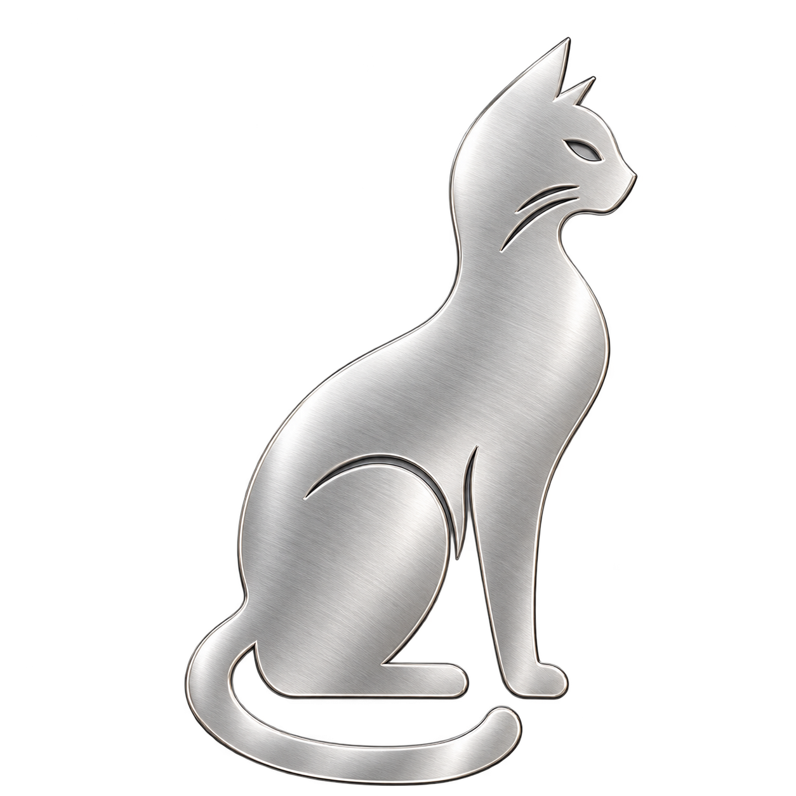
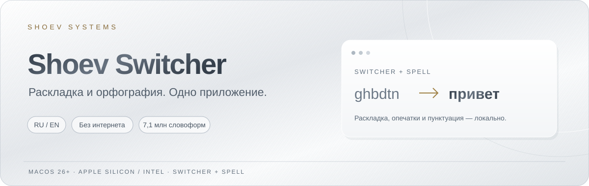

<p align="center">
  
</p>

<p align="center">
  
</p>

<p align="center">
  <a href="https://github.com/TiDazai/Shoev-Switcher/actions/workflows/ci.yml"></a>
  <a href="https://github.com/TiDazai/Shoev-Switcher/releases"></a>
  
  
</p>

<p align="center">
  <strong>Русский и английский без лишних переключений.</strong><br>
  Раскладка и орфография в одном приложении для Mac. Всё локально.
</p>

<p align="center">
  <a href="https://github.com/TiDazai/Shoev-Switcher/releases/download/v0.6.3/Shoev-Switcher.dmg"><strong>Скачать для macOS 26+ · DMG</strong></a>
  &nbsp; · &nbsp;
  <a href="CHANGELOG.md">Что нового</a>
</p>

# Shoev Switcher — раскладка и орфография

Разработано компанией **SHOEV SYSTEMS**. Автор — **Shoev Timur (TiDazai)**.

Shoev Switcher is an offline Russian–English keyboard layout and spelling app for macOS, made by SHOEV SYSTEMS.

Shoev Switcher предназначен только для **macOS 26 и новее**. Текущая версия доступна как [предрелиз 0.6.3](https://github.com/TiDazai/Shoev-Switcher/releases/tag/v0.6.3). Совместимость текстовых полей зависит от редактора.

## Просто продолжай писать

Shoev Switcher для macOS объединяет два независимых модуля в одном приложении. Главное окно оформлено в графитовой, платиновой и золотой палитре; кошка в строке меню позволяет быстро открыть его или включить и выключить модули.

| Модуль | Что делает |
| --- | --- |
| Switcher | Исправляет неверную раскладку и переключает RU ↔ EN |
| Spell | Исправляет опечатки, заглавные буквы и помогает с русской пунктуацией |

Можно оставить только Switcher, только Spell, включить оба или выключить оба. В окне есть отдельные настройки каждого модуля и общий зашифрованный дневник. Закрытие окна не завершает приложение.

| Набрано | Получится |
| --- | --- |
| `ghbdtn` | привет |
| `f vj;yj` | а можно |
| `руддщ` | hello |

Корректные английские слова вроде `hi` не нужно переводить. Для неоднозначных слов учитываются частоты, последние слова фразы и личные правила — автоматическое распознавание не всегда может угадать намерение.

Enter, Shift+Enter и Tab проходят в приложение без перехвата: отправку сообщения, перенос строки и переход между полями определяет сам редактор. Автоматическое исправление выполняется на пробеле или знаке препинания, не на Enter.

## SHOEV SYSTEMS

Приложения SHOEV SYSTEMS для работы с русским и английским текстом:

- **Shoev Switcher** — исправление неверной раскладки и автоматическое переключение RU ↔ EN.
- **[Shoev Spell](https://github.com/TiDazai/Shoev-Spell)** — исправление опечаток, заглавные буквы и помощь с русской пунктуацией.

С версии 0.6.0 для macOS функции Spell входят в Shoev Switcher. Отдельный Shoev Spell сохранён как самостоятельный продукт. Если он запущен, встроенный модуль Spell приостанавливается, чтобы два обработчика не исправляли текст одновременно. Завершить отдельный Spell можно кнопкой в главном окне; его приложение и данные не удаляются.

## Установка на Mac

1. Открой [DMG для macOS 26+](https://github.com/TiDazai/Shoev-Switcher/releases/download/v0.6.3/Shoev-Switcher.dmg) и перетащи приложение в **Applications**.
2. Запусти Shoev Switcher.
3. Разреши **Мониторинг ввода** и **Универсальный доступ** в настройках macOS.
4. Убедись, что добавлены русская и английская раскладки.

Требуется **macOS 26+**. **Apple Silicon и Intel** — в одном приложении; версии macOS до 26 больше не поддерживаются. Архивные релизы сохраняют прежние системные требования.

Текущая общедоступная сборка не нотарифицирована Apple. При первом запуске macOS может её заблокировать: используй «Всё равно открыть» в «Системные настройки → Конфиденциальность и безопасность», если доверяешь источнику.

## Под рукой

- **Автоматическое RU ↔ EN** — словарь уже внутри, сеть не нужна.
- **Независимый Spell** — орфография, заглавные буквы, пунктуация и отдельные исключения по приложениям.
- **Главное окно** — обзор состояния, настройки Switcher, настройки Spell и дневник обоих модулей.
- **Двойной Shift** — вручную перевести выделение, текущее или последнее слово. Левый или правый Shift выбирается в настройках.
- **Backspace после исправления** — вернуть исходное слово без скрытых исключений.
- **Флаг возле мыши** — язык ввода над текстовым полем, без привязки к каретке.
- **Настройки по функциям** — контекст, флаг, уведомления, память раскладки, обучение и дневник можно отключить отдельно.
- **Исключения по приложениям** — терминалы и IDE исключены по умолчанию.
- **Дневник и правила** — поиск, «никогда не менять», «всегда менять», свои слова, импорт и экспорт JSON.
- **Самообучение** — повторное ручное исправление может стать личным правилом; выученные правила можно удалить.
- **Автозапуск и память раскладки** — по желанию.

## Словари внутри

**7 120 939 записей:** 4 020 787 русских и 3 100 152 английских слов и словоформ. В корпус входят морфология, имена, фамилии, географические названия, бренды, технические термины, сленг и ненормативная лексика.

Это большой корпус, а не обещание знать каждое существующее слово. Личные словари дополняют его без пересборки приложения. Данные и их лицензии перечислены в [THIRD_PARTY_NOTICES.md](THIRD_PARTY_NOTICES.md).

## Текст остаётся на устройстве

Нет облачных API и телеметрии. Журнал обоих модулей и пользовательские правила хранятся локально с шифрованием AES-GCM. Полный дневник набора выключен по умолчанию. Для резервной вставки буфер обмена временно используется и затем безопасно восстанавливается.

Перед заменой Switcher проверяет текущее поле, курсор и исходный текст через Accessibility. В защищённых полях, при Secure Event Input и там, где приложение не позволяет безопасно прочитать и изменить текст, автоматическая замена пропускается. Совместимость зависит от конкретного редактора и поля; универсальная работа во всех приложениях не гарантируется.

Автоматическое исправление выполняется после обработки настоящего пробела или знака препинания; изменившийся текст или курсор отменяет отложенную замену. Если редактор игнорирует прямую замену, Switcher пробует Cmd+V в подтверждённое выделение. Буфер временно содержит исправление и восстанавливается после подтверждения вставки, только если пользователь не скопировал что-то новое. Все доступные форматы сохраняются; слишком большой или недоступный буфер не используется. Не подтверждённая редактором вставка не вызывает преждевременного восстановления буфера. Switcher и Spell используют общую блокировку, чтобы не менять его одновременно.

Подробнее: [приватность](docs/PRIVACY.md) · [архитектура](docs/ARCHITECTURE.md).

## Разработка

macOS 26+ — Swift Package, Xcode 26+ и соответствующие Command Line Tools:

```bash
./scripts/prepare-lexicon.sh
swift test
./scripts/create-dmg.sh
```

Результат: `dist/Shoev-Switcher.dmg`. Скрипт создаёт свежую универсальную сборку, проверяет подпись приложения и контрольную сумму образа. Для сохранения разрешений при локальной разработке можно один раз выполнить `./scripts/setup-local-signing.sh`.

[Сообщить об ошибке](https://github.com/TiDazai/Shoev-Switcher/issues/new/choose) · [Участие в разработке](CONTRIBUTING.md) · [Лицензии словарей](THIRD_PARTY_NOTICES.md)

---

<p align="center"><strong>SHOEV SYSTEMS</strong><br><sub>Небольшие инструменты для повседневной работы.</sub></p>
